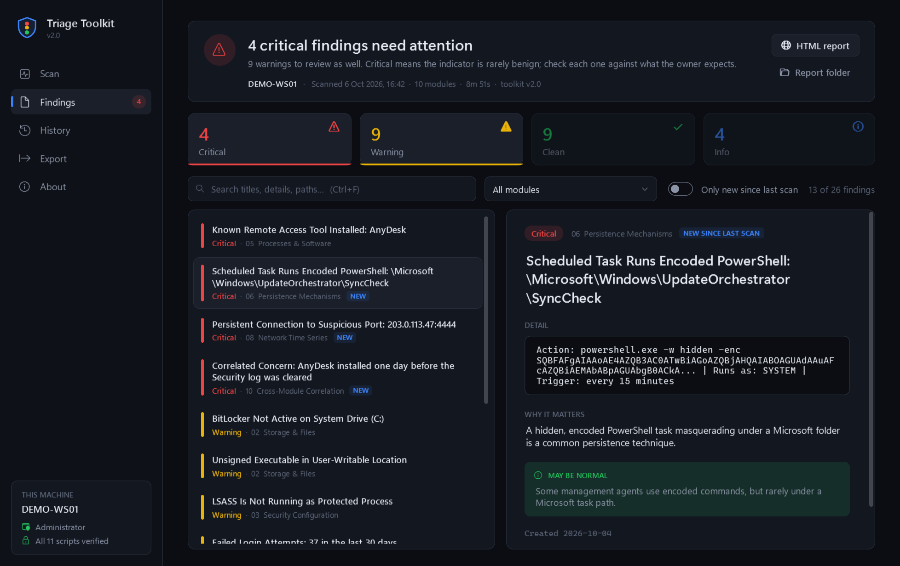
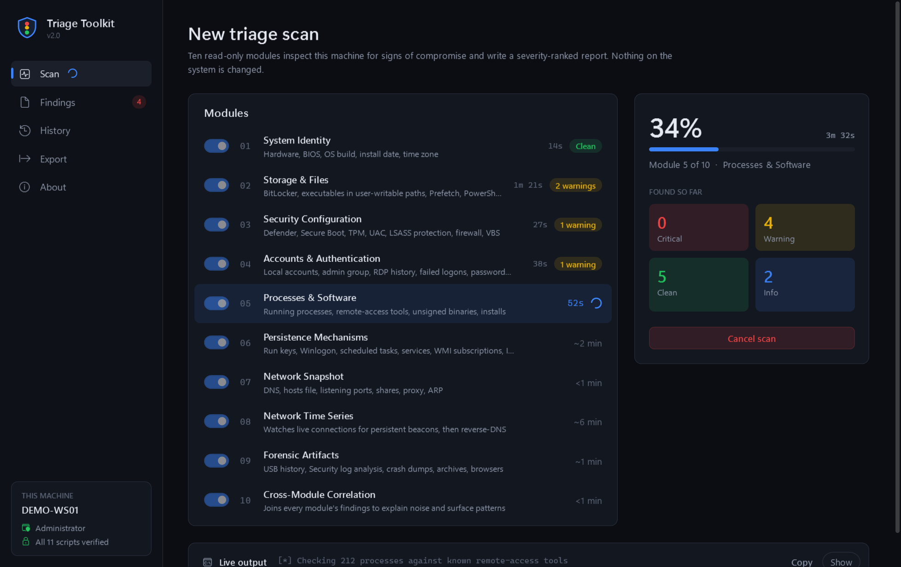
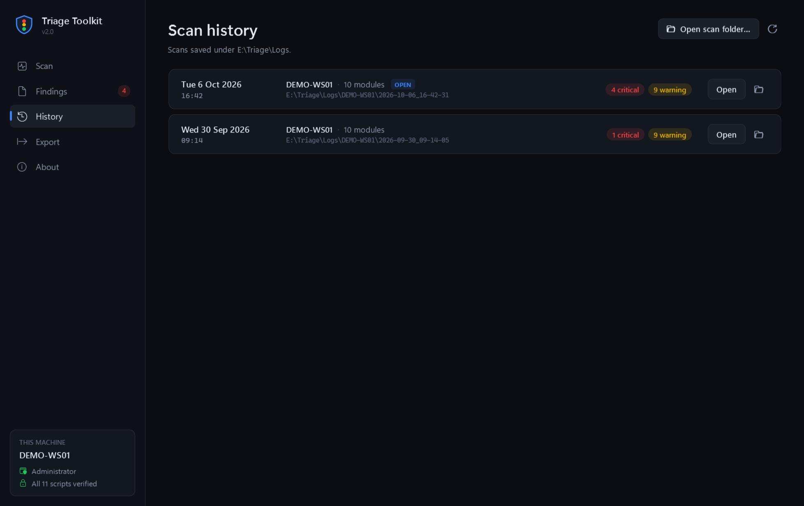
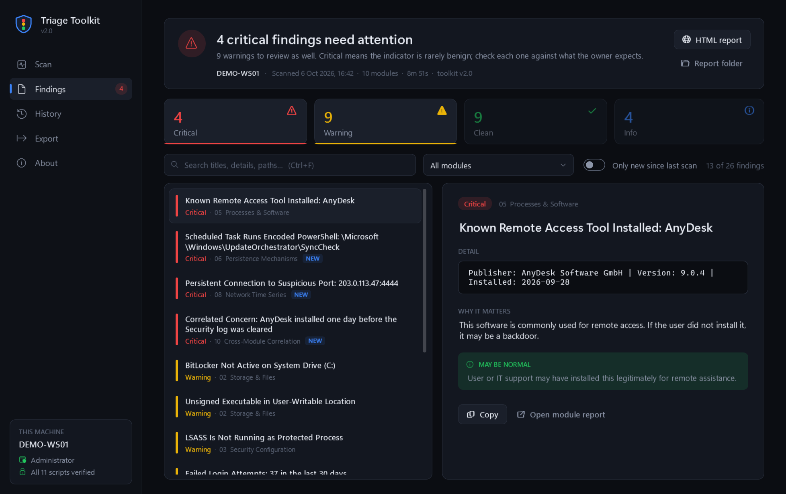
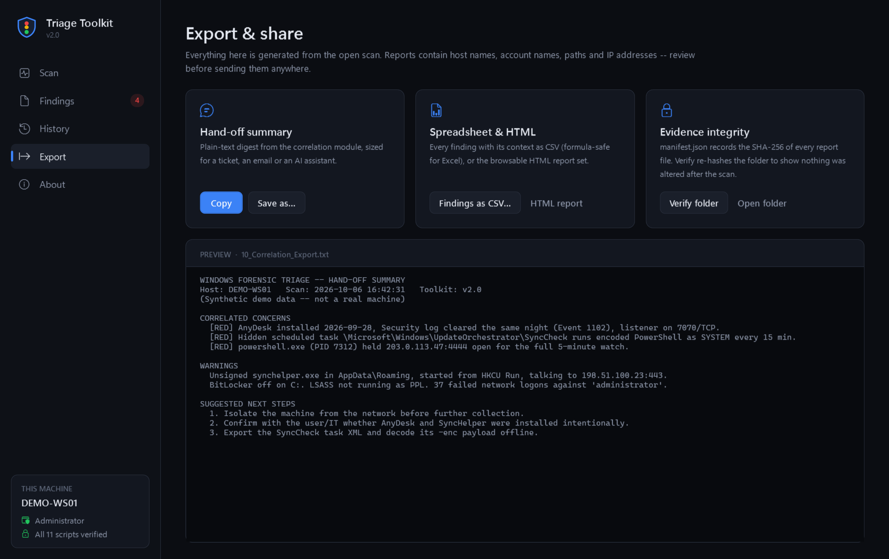

# Windows Forensic Triage Toolkit

**A portable, read-only first look at a Windows machine you think might be compromised.**

Copy one `.exe` to the machine, run it, and in about ten minutes you have a severity-ranked answer: what looks wrong, why it matters, and when it might be perfectly normal. No install, no PowerShell knowledge, nothing changed on the system.

[](https://github.com/maximstark/WindowsForensicTriageToolkit/actions/workflows/build.yml)
[](https://github.com/maximstark/WindowsForensicTriageToolkit/releases/latest)

[](LICENSE)



<sub>All screenshots use the synthetic `DEMO-WS01` scan in [`samples/`](samples/). No real machine is shown.</sub>

---

## What it does

Ten PowerShell modules collect evidence the way an incident responder would on a first visit. They cover identity, storage, security controls, accounts, processes, persistence, the network snapshot and a timed watch of live connections, plus event-log artifacts. A correlation pass then joins their output, so a run key created the same day a known program was installed is *explained* rather than flagged. A remote-access tool that arrived the night the Security log was cleared is *escalated*.

Every finding carries a traffic-light severity and two plain-English notes: **why it matters** and **when it may be normal**.

| Severity | Meaning |
|---|---|
| 🔴 **Critical** | Rarely benign. Check each one against what the owner expects. |
| 🟡 **Warning** | Worth a look; often explained by ordinary software. |
| 🟢 **Clean** | A check that passed, such as Defender active, Secure Boot on, or no WMI persistence. |
| 🔵 **Info** | Context for reading everything else. |

## The desktop app

Version 2.0 replaces the old WinForms launcher with a full WPF application.

<table>
<tr>
<td width="50%"></td>
<td width="50%"></td>
</tr>
<tr>
<td><b>Scan.</b> Pick modules, set how long to watch the network (1 to 10 min), and follow each module's live status, timing and result counts. Taskbar progress and a flash when it finishes; the full PowerShell output is one click away.</td>
<td><b>History.</b> Every scan is a self-contained folder. Re-open any of them, including folders collected from <i>other</i> machines on a USB stick.</td>
</tr>
<tr>
<td></td>
<td></td>
</tr>
<tr>
<td><b>Findings.</b> Severity tiles double as filters, with full-text search, a module filter and master/detail reading. <b>New since last scan</b> diffs against the previous scan of the same host.</td>
<td><b>Export.</b> A plain-text hand-off summary for a ticket or an AI assistant, CSV export (formula-safe), the HTML report set, and one-click verification of the evidence manifest.</td>
</tr>
</table>

It also has keyboard shortcuts (<kbd>Ctrl</kbd>+<kbd>1</kbd> to <kbd>5</kbd> for pages, <kbd>Ctrl</kbd>+<kbd>F</kbd> to search, <kbd>Ctrl</kbd>+<kbd>Enter</kbd> to start, <kbd>Ctrl</kbd>+<kbd>O</kbd> to open a scan), a native dark title bar, per-monitor DPI and the modern Windows folder picker.

### Command line

For scripted incident response, from an elevated prompt:

```cmd
start /wait TriageToolkit.exe --headless --out D:\Evidence --net-minutes 2
echo %ERRORLEVEL%
```

The exit code is the verdict: `0` clean, `1` warnings, `2` critical, `3` error or cancelled. `--modules 01,03,06` and `--skip 08` choose modules, `--quiet` trims output, and `--open <scan folder>` opens the app on an existing scan.

## Quick start

1. Download `TriageToolkit.exe` from the [latest release](https://github.com/maximstark/WindowsForensicTriageToolkit/releases/latest).
2. Copy it to the machine you want to examine. A USB stick is ideal, because reports are saved beside the exe.
3. Double-click it and accept the UAC prompt.
4. Press **Start scan**. A full scan takes about 10 to 15 minutes, five of which are the network watch. **Quick** skips that watch.

Requirements: Windows 10 or 11. The app runs on the .NET Framework 4.8 and PowerShell 5.1 that ship with Windows.

## Modules

| # | Module | What it checks |
|---|---|---|
| 01 | System Identity | Hardware, BIOS, OS build, install date, time zone |
| 02 | Storage & Files | BitLocker, executables in user-writable paths, Prefetch, PowerShell history |
| 03 | Security Configuration | Defender, Secure Boot, TPM, UAC, LSASS protection, firewall, VBS |
| 04 | Accounts & Authentication | Local accounts, admin group, RDP history, failed logons, password policy |
| 05 | Processes & Software | Running processes, remote-access tools, unsigned binaries, recent installs |
| 06 | Persistence | Run keys, Winlogon, scheduled tasks, services, WMI subscriptions, IFEO |
| 07 | Network Snapshot | DNS, hosts file, listening ports, shares, proxy, ARP |
| 08 | Network Time Series | Samples live connections (1 to 30 min) to catch persistent beacons, then reverse DNS |
| 09 | Forensic Artifacts | USB history, Security log analysis, crash dumps, archives, browser profiles |
| 10 | Cross-Module Correlation | Explains noise and surfaces patterns across all of the above |

## What it changes (and what it doesn't)

The toolkit is **read-only** toward the system it examines. It makes no registry writes, creates no services or scheduled tasks, installs nothing, and attempts no remediation. Its only network traffic is the reverse-DNS lookups in module 08.

It writes exactly two things:

- **The report folder** you choose (by default `Logs\` beside the exe).
- **A temporary script workspace** in `%ProgramData%`, deleted when the scan ends.

Scan history is simply those folders, so run from a USB stick, the toolkit leaves its records with the evidence rather than in the examined machine's profile. PowerShell itself may refresh its own module-analysis cache, as it does whenever it runs.

## Security model

A triage tool runs as administrator on a machine that may already be hostile, so v2.0 treats its own inputs as untrusted:

- **Script integrity.** The SHA-256 of every embedded script is compiled into the exe at build time. Scripts are checked when extracted and again immediately before each module runs. A mismatch stops the scan.
- **Locked workspace.** Scripts are extracted to a randomly named folder directly under `%ProgramData%`, created with an ACL that grants access only to Administrators and SYSTEM. v1.5 used the user's `%TEMP%`, where any process running as that user could swap a script between extraction and the elevated PowerShell reading it.
- **No PATH lookups.** `powershell.exe` and `taskkill.exe` are launched by absolute System32 path.
- **Reports are escaped.** Finding text includes attacker-controllable strings such as PowerShell history lines, task names and registry values. All of it is HTML-encoded, so a planted `<script>` can't run in the report, and CSV cells are guarded against spreadsheet formula injection.
- **Un-elevated viewing.** Reports, folders and links open through Explorer, so the browser doesn't inherit the toolkit's admin token.
- **Evidence manifest.** Each scan ends by writing `manifest.json`, with the SHA-256 of every report file. **Export ▸ Verify folder** re-hashes a copied folder to show nothing changed after collection.

See [SECURITY.md](SECURITY.md) to report a vulnerability.

## A scan folder

```
Logs\DEMO-WS01\2026-10-06_16-42-31\
├── 00_Summary.html            one-page index: verdict, per-module table, findings to review
├── 01_SystemIdentity.html     full report per module (collapsible sections)
├── 01_System_Identity.json    machine-readable findings per module
├── …
├── 10_Correlation_Export.txt  plain-text hand-off summary
├── scan.json                  timing, options, per-module outcome
├── scan.log                   full console transcript
└── manifest.json              SHA-256 of every file above
```

Browse a real example: [`samples/DEMO-WS01`](samples/DEMO-WS01).

## Building from source

There's nothing to install. The build uses the `csc.exe` and WPF assemblies that ship with Windows. The XAML is embedded and parsed at runtime, so no XAML compiler or SDK is needed.

```powershell
git clone https://github.com/maximstark/WindowsForensicTriageToolkit.git
cd WindowsForensicTriageToolkit
.\build.ps1                 # -> build\TriageToolkit.exe, build\checksums.json
.\tests\Run-Tests.ps1       # library + app tests (app tests need an elevated prompt)
```

To audit or tweak the scripts directly, `src\00_LAUNCHER.bat` runs all ten modules from source into one report folder.

To regenerate the demo scan and the screenshots above:

```powershell
.\tools\New-DemoScan.ps1
.\build\TriageToolkit.exe --render-docs docs\screenshots --scan samples\DEMO-WS01\2026-10-06_16-42-31 --baseline samples\DEMO-WS01\2026-09-30_09-14-05
```

How the pieces fit is described in [docs/ARCHITECTURE.md](docs/ARCHITECTURE.md), and the release history is in [CHANGELOG.md](CHANGELOG.md).

## License

MIT. See [LICENSE](LICENSE).

**Use it on machines you own or are authorized to examine.** It is a triage aid, not a verdict. A clean scan is not proof that a machine is uncompromised, and every critical finding deserves a human look before anyone acts on it.
